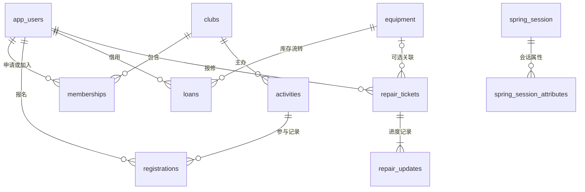

# 数据库设计

使用 PostgreSQL 17，应用通过 Spring Data JPA 读写。表、外键、唯一约束、状态约束和索引由 `backend/src/main/resources/db/migration/V1__initial_schema.sql` 创建，启动时 Flyway 自动迁移，Hibernate 只验证结构，不自动修改表。

## 关系图

## 主要字段

| 表 | 关键字段 | 约束与含义 |
| --- | --- | --- |
| `app_users` | username、password_hash、name、email、student_no、department、bio、role、enabled | 用户名和邮箱唯一；密码仅存 BCrypt 哈希；角色 STUDENT / ADMIN |
| `clubs` | name、category、summary、description、icon、color、location、contact、recruiting、active | 名称唯一；招新和运营分别控制 |
| `memberships` | user_id、club_id、reason、status、review_note、reviewed_at | 用户和社团联合唯一；重申请复用关系记录 |
| `activities` | club_id、title、category、description、location、starts_at、ends_at、registration_deadline、capacity、checkin_code、featured、status | 名额大于 0；结束晚于开始；报名截止不晚于开始 |
| `registrations` | user_id、activity_id、checked_in_at | 同一用户对同一活动只能报名一次；取消报名释放名额 |
| `equipment` | name、category、asset_code、description、location、total_quantity、available_quantity、active | 资产编号唯一；0 ≤ 可用数量 ≤ 总数量 |
| `loans` | user_id、equipment_id、quantity、purpose、due_date、status、review_note、returned_at | 数量大于 0；批准扣库存，验收归还加库存 |
| `repair_tickets` | user_id、equipment_id、title、description、location、priority、status、updated_at | 可关联器材，支持一般地点报修 |
| `repair_updates` | ticket_id、operator_name、status、note、created_at | 保存每次处理的状态、说明、操作者与时间 |
| `spring_session` | primary_id、session_id、creation_time、expiry_time、principal_name | 数据库持久化会话与账号索引 |
| `spring_session_attributes` | session_primary_id、attribute_name、attribute_bytes | 保存安全上下文与 CSRF 等会话数据 |

业务表使用 BIGINT 自增主键，`created_at` 为 `TIMESTAMPTZ`；活动与审核记录使用绝对时间，前端按访问设备时区显示（校园部署使用中国时区）。预计归还日期使用 DATE，服务器按 Asia/Shanghai 判断是否逾期。

## 状态流转

### 入社

`PENDING（待审核）→ APPROVED（已通过）/ REJECTED（已驳回）`

学生可从待审核或已通过改为 `WITHDRAWN（撤回/退出）`；驳回或退出后可重新申请。社团关闭招新时拒绝新申请。

### 活动

活动为 `PUBLISHED / CANCELLED`，是否报名中、进行中或已结束由时间和名额计算。取消活动保留报名记录，允许用户取消尚未签到的报名。已签到记录保留。

### 器材借还

`PENDING → APPROVED → RETURN_PENDING → RETURNED`

待审核也可由管理员变为 `REJECTED`，或由申请人变为 `CANCELLED`。只有审批通过时扣库存；归还申请仍占用库存；管理员验收一次后恢复。归还期限限制为申请日起 90 天内。

### 维修

`OPEN → PROCESSING → RESOLVED → CLOSED`

维修中可补充进度；已修复可重新进入维修中。关闭后不能继续修改，所有进度均记录在 `repair_updates`。

## 事务与并发

- 活动报名锁定活动行，再统计当前报名人数，避免两位用户抢占最后一个名额时超额。
- 借用审核先锁定申请，再锁定器材行；归还验收沿用相同顺序，防止重复增加库存。
- 调整器材总数锁定器材行，按原在借数量重新计算可用量，禁止减至在借数量以下。
- 审核与撤回成员申请、活动签到与取消报名均锁定相应记录。
- 数据库外键、CHECK 与 UNIQUE 约束作为最终一致性保护。

## 初始化与迁移

`scripts/database.ps1` 自动创建本地业务库和测试库，Flyway 在应用首次启动时执行迁移。正式环境由数据库平台创建数据库，应用账号需具有当前 schema 的建表、建索引和业务读写权限。

后续结构更改应新增 `V2__描述.sql` 等迁移，不要修改已经在正式环境执行过的 V1。演示数据由 `SeedData` 在显式开启演示模式且社团表为空时生成，重复启动不重建。

## V2 征途俱乐部迁移

`V2__zhengtu_cycling_identity.sql` 归档原始八个通用示例社团、取消对应示例活动、停用六种示例器材，并创建“征途单车俱乐部”。成员、借还、签到和维修历史不删除。前台活动和成员统计按运营中俱乐部计算，避免旧社团数据混入征途统计。库存及活动安排需管理员确认后录入。

简介版迁移 V4：仅按俱乐部名称更新征途单车俱乐部的 summary 和 description，来源为用户提供的简介；不变更表结构、历史业务、用户权限或库存。
